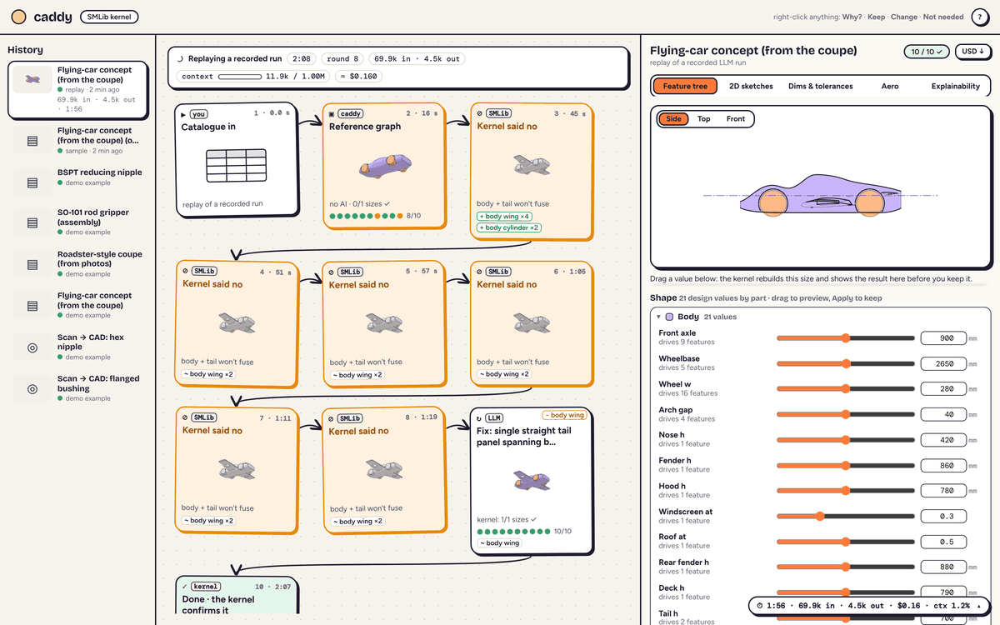
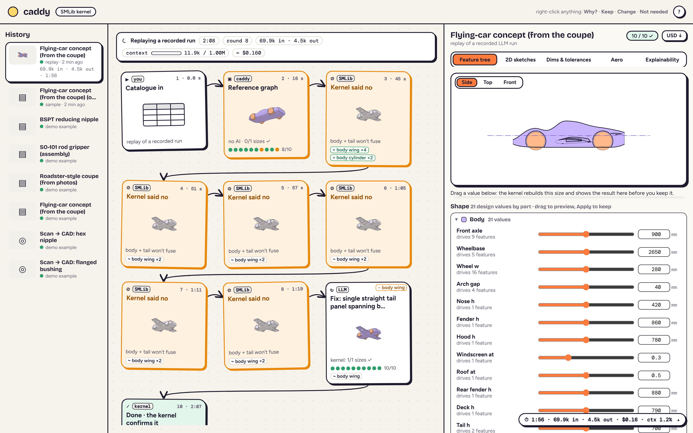
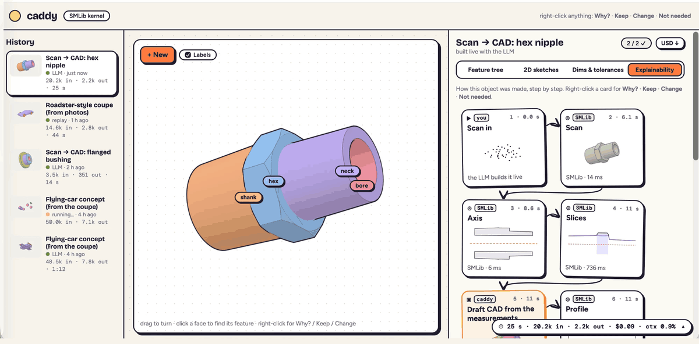
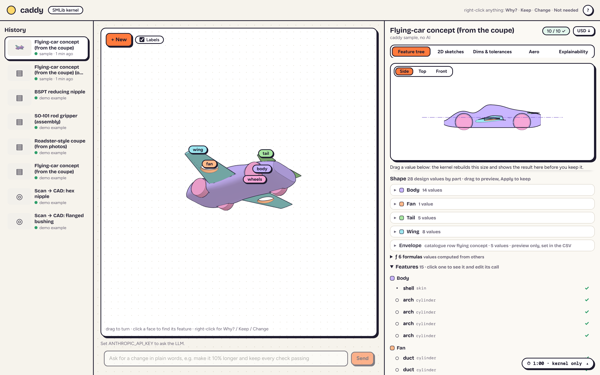
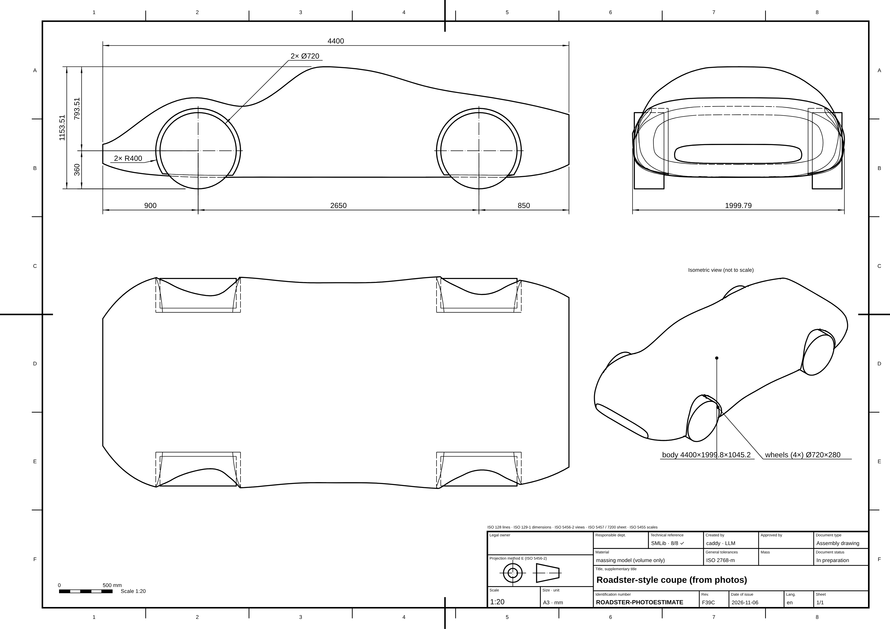
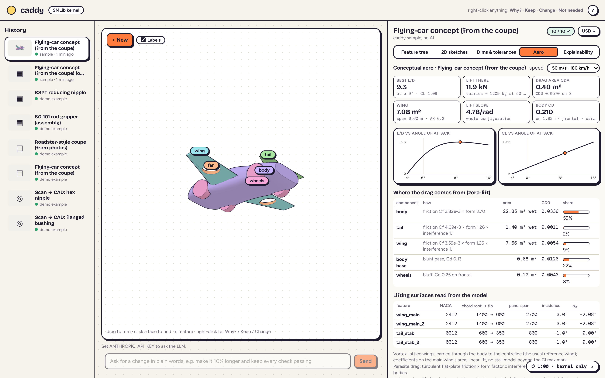
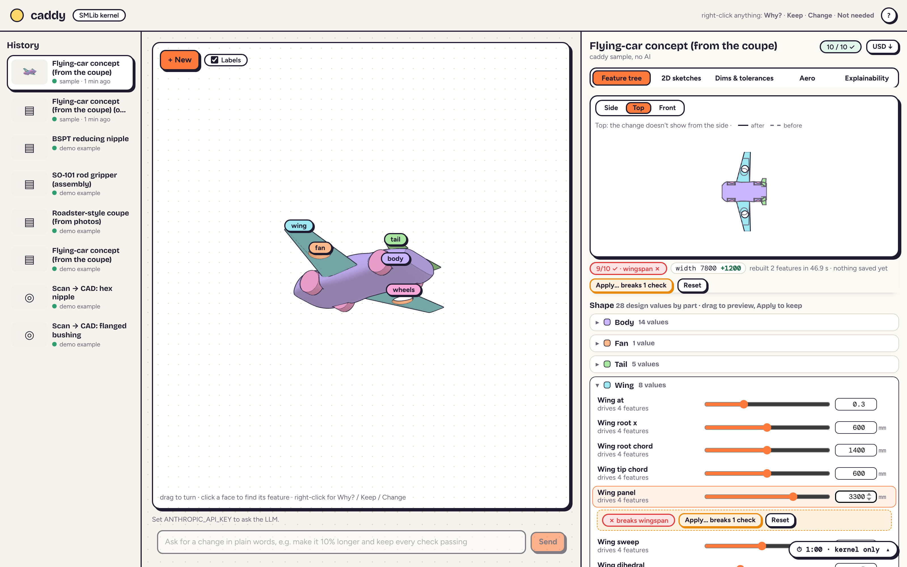
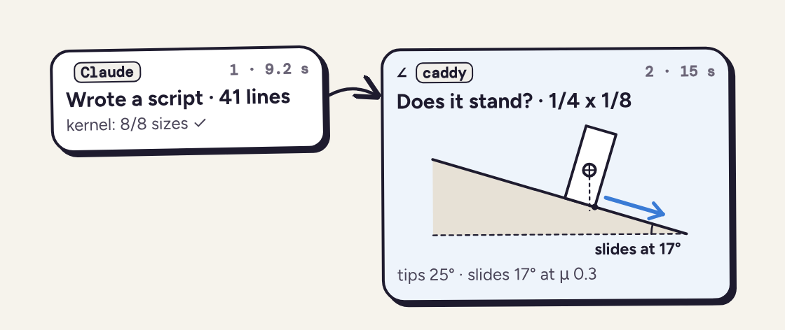

# caddy

**Claude designs the part, the kernel proves it, and you see and steer every decision on a whiteboard.**



caddy is an AI CAD tool built on **NVIDIA's SMLib B-rep kernel**. Claude writes a short parametric script; SMLib
builds the exact solid and measures every requirement; the engineer watches each step on a live whiteboard, changes
values with sliders the kernel previews, and asks "why?" about anything.

## The problem

The problem with current AI CAD tooling is that a variety of companies are pursuing the LLM wrapper approach: a model
writes a script, looks at renders, and rewrites the whole thing when something is wrong. That creates four problems:

1. **Are designs actually verifiable beyond orthographic renderings?** A render shows what a part looks like, not
   whether it meets its dimensions, fits its neighbours or is even a valid solid.
2. **How can we ground LLM outputs in physics for performance-based modifications?** Engineers ask for behaviour
   (design this X so it doesn't tip over when pushed), not just shape.
3. **Are LLM solutions and models interpretable enough for engineers to modify and iterate on the design intent and
   logic?** To edit a model, you have to understand it.
4. **LLM CAD can actually be slower than a human doing the thing, and it can be expensive.** Every small edit means
   another round of renders and a full rewrite.

I aimed to resolve each of these leveraging some existing work of mine in this area.

| Problem | Solution | Status |
|---|---|---|
| 1. Verification | **The SMLib kernel as the judge, with smlibquery as the language.** Every requirement (catalogue cells, ISO rules, fits, clearances) is measured on the exact solid, and the agent can't call a design done while any check fails. smlibquery models the success of CadQuery but runs on the SMLib kernel. LLMs need an effective interface between the actual model and its metadata, like feature trees, to efficiently make modifications and interpret results. | ✅ built |
| 2. Physics | **Kernel physics plus my [behaviors](https://github.com/ghanemja/behaviors) experiment.** The kernel gives exact mass, fit, clearance, and the angles at which a body tips or slides; an aero estimate comes from the model's own wings. The behaviors experiment is just an experiment, but it demonstrates the concept of arming LLMs with real physics knowledge to drive designs by real behavior, by providing a lookup table of objects (2,166 NVIDIA SimReady objects today, which can be replaced with real CAD in the future). | 🟡 stability and aero built (advisory); behaviour search is vision |
| 3. Interpretability | **cadboard**, a whiteboard for CAD, for interpretability, insight, and quick inline inquiry into the design and iteration process: each step with its reasons, a feature tree with sliders, and "Why?" on anything. | ✅ built |
| 4. Speed and cost | **cadboard is also targeted at reducing the cost of iteration.** Slider edits go straight to the kernel with 0 tokens, and agent fixes are small diffs (51–593 characters) instead of full rewrites. | ✅ built |

**Thesis:** the B-rep kernel is the translation layer: exact geometry in, a compact named description out, edits as
small diffs. Text beats pixels for CAD (BenchCAD reports ≈0.84 from code vs ≈0.59 from images when answering
questions about a part). **One representation, two readers:** cheaper for the model, legible to the engineer.

How I approached it, from market research to the build: [Process](docs/PROCESS.md). Decisions, limitations, reused
components and next steps: [Notes](Notes.md).

Spec-driven docs: [Intent](docs/INTENT.md) → [Spec](docs/SPEC.md) (requirements with IDs and acceptance criteria) →
[Design](docs/DESIGN.md) → [Decisions](docs/DECISIONS.md) → [Milestones](docs/MILESTONES.md) →
[Tasks](docs/TASKS.md) → [Verification](docs/VERIFY.md) (which test proves which requirement). What changed recently:
[Changelog](docs/CHANGELOG.md).

## Quick start

```bash
git clone https://github.com/ghanemja/caddy.git && cd caddy
```

**Docker (any OS, including macOS).** NVIDIA's `usd-brep` ships Linux and Windows wheels only, so Docker is the easy
path. The first build downloads the SMLib wheel and takes a few minutes.

```bash
docker compose up --build
```

Open **http://localhost:8000**.

**Native (Linux, Python 3.12),** if you'd rather not use Docker:

```bash
python3.12 -m venv .venv
.venv/bin/pip install -r requirements.txt
.venv/bin/python -m caddy --port 8000
```

Tests: `.venv/bin/python -m pytest -q tests packages/smlibquery/tests` (131 pass; 3 skip because their
recordings aren't in the repo and 4 more skip unless `solidcraft-cli` is installed; about 3.5 min. What each test proves is in [Verification](docs/VERIFY.md)). Browser smoke test
(Node + Playwright + Chromium): `node tests/e2e/smoke.mjs`.

**Try it in two minutes (no API key needed).** On your first visit a short tour walks through a replay for you (skip it
any time; **?** in the header brings it back). Or by hand:
1. **New → Flying-car concept → ▶ Replay.** A recorded Claude run replays on the real kernel: the coupe is built,
   then Claude adds wings, lift fans and a tail. Watch the whiteboard; steps the kernel rejects show in orange.
   (**sample** loads caddy's reference design instead; the cars take a minute or two to build.)
2. **Feature tree:** open the *Wing* group and change *Wing panel*. The kernel previews it (before/after drawing and
   3D) before you **Apply**.
3. **2D sketches** (ISO or ASME sheet), **Aero** (L/D from the model's own wings), and right-click anything for
   **Why? / Keep / Change / Not needed**.

- **Build with Claude** (live) needs `ANTHROPIC_API_KEY`: export it, or put `ANTHROPIC_API_KEY=...` in a `.env` next to
  `docker-compose.yml`.
- **Picture → parametric CAD** needs `ANTHROPIC_API_KEY` and [SolidCraft](https://solidcraft.io/download)'s
  `solidcraft-cli` on `PATH` (or `SOLIDCRAFT_CLI=/path/to/solidcraft-cli`; in Docker, mount it and set the variable).
  Drop a PNG or JPEG on **New**, or run `python -m caddy.solidcraft chair.jpg --hint "dining chair, seat 450 mm high"`.
- Scan → CAD also uses `smlibpy` (in `requirements.txt`) to read meshes and STEP files, which `usd-brep` can't.

## What I built, in order

**1. Kernel layer: exact geometry in, a named description out.** Every face of the solid is labelled with the
feature and part that made it. The model reads this digest instead of renders:

```text
family bspt_hex_reducing_nipple · size 1/4 x 1/8 · closed ✓ · volume 3378.3 mm³ · 27 faces
part hex  blocks: hex_prism, hex_chamfer, hex, join_inlet  params: hex_af, hex_len, chamfer_deg
  hex.flat[0..5] 6x plane z 15.000–21.000
  hex.chamfer[0..13] 14x cone z 15.000–21.000
part bore  blocks: bore, cut_bore  params: bore_d
  bore.wall cylinder Ø5.000 z 0.000–31.000
checks 9/9 ✓  overall_len 31.0 · hex_af 15.0 · ... · thread_clears_hex 13.7195
```

**2. The kernel as the judge.** A BSPT reducing nipple: one model, 8 catalogue sizes, every catalogue cell and ISO 7-1
rule measured on the exact solid. `finish` is refused while any check fails, and fixes go in as small diffs. The
first build caught a real problem: on the ¾-inch sizes the thread cone breaks through the hex. Every run is logged
with the kernel's verdict at each step, so the same checks ("parts compile", "references stay stable") could serve as
reward signals for post-training.

**3. cadboard: a whiteboard for CAD.** Each step of the agent is a card with its picture, reason and kernel verdict,
kept with the object as its explanation. Right-click anything for *Why?*, *Keep* (enforced by the kernel layer),
*Change* or *Not needed*. The explanations on the cards go to the UI, not the model, so they cost no tokens. Here it
is replaying the flying-car run: the orange cards are builds SMLib rejected, each with the reason and the features
involved:



**4. smlibquery: CadQuery's style, SMLib's kernel.** I built smlibquery, a new library that sits directly on NVIDIA
SMLib. Its interface is inspired by CadQuery, because LLMs already know CadQuery well, but everything underneath runs
on SMLib, not OpenCascade. Claude writes fluent CadQuery-style code. It compiles to a typed intermediate
representation that keeps expressions (`hex_af / 2`, not `7.5`), so one script builds every catalogue size, every
number on cadboard traces back to a line of code, and an edit rebuilds only the blocks it touches:

```python
import smlibquery as sq

hexagon = (sq.Workplane("XY").workplane(offset=inlet_thread_len)
           .polygon(6, hex_af / cos(radians(30))).extrude(hex_len).tag("hex.flat"))
result = inlet.union(hexagon).union(outlet).faces(">Z").workplane().hole(bore_d).tag("bore.wall")
```

A call smlibquery doesn't support fails with the line and a suggestion instead of being approximated.

**5. Scan → CAD.** Scans of turned parts become editable scripts on the same kernel, with every scan point checked
against the solid. Here a hex nipple scan becomes CAD with Claude: the whiteboard shows axis, slices, profile and
primitives found on the kernel, then the draft and Claude's fix; every scan point lands within 0.1 mm of the model;
the drawing sheet comes from the same solid; and moving a value shows when it would pull the model off the scan.



**5b. Picture → parametric CAD, with SolidCraft.** Drop a picture of an object and the LLM models it in
[SolidCraft](https://github.com/tangency-labs/solidcraft), an open-source parametric CAD it drives through MCP: named
parameters, a feature timeline, mirrors and patterns. caddy stays the judge. After every change it exports the
design, reads it into SMLib and measures it, and `finish` is refused until:

- the solids SMLib reads back are closed and have the volume SolidCraft reports;
- the object is its own mirror image across the plane the model declared (every surface point, mirrored, lands back
  on the model). Symmetry is the default: chairs, tables, couches and aircraft are assumed symmetric, with hidden
  sides mirroring the visible ones, unless the model says what in the picture shows otherwise;
- every named parameter rebuilds without errors and actually moves the geometry (tried larger and smaller);
- the model's outline, seen as the picture was taken, overlaps the object in the picture.

You get `model.sc` to keep editing in SolidCraft, the STEP file SMLib judged, and the same whiteboard, viewer and
drawing sheets as any caddy object. Moving a value in the Feature tab rebuilds the timeline in SolidCraft and judges
the result on SMLib before you keep it, with no model call. This is tested end to end with a scripted stand-in for
the model; a live run on a real photo hasn't been recorded yet ([Verification](docs/VERIFY.md)).

**6. Freeform on the kernel.** Two ops CadQuery doesn't have: `skin()` lofts a smooth body through cross-sections, and
`wing()` makes NACA airfoil panels. A Roadster-style coupe from two photos, then the flying car, which came from
Zach's post on X: "the flying cars of the future will be designed by agents." Lofted bodies are where SMLib is
weakest: its distance query read a 40 mm tyre gap as touching, so caddy re-measures on the exact surfaces there.
Meshes are tessellated relative to the part's size, which took the car from 33 MB to 0.4 MB and halved rebuilds with
identical checks.



**7. Drawings and aero from the same model.** ISO or ASME sheets with hidden lines, sections and kernel dimensions;
a vortex-lattice aero estimate from the model's own wings (best L/D 9.3 for the flying car at 50 m/s, labelled as an
estimate, not CFD).

| | |
|---|---|
|  |  |

**8. Change a value, see it first.** Values grouped by part; move one and SMLib rebuilds the size so you see before
and after. If it would break a check, the kernel finds a value that doesn't. Value changes cost no model call.



**9. Stability, with my behaviors lookup.** Ask whether a body stands. The kernel gives the tilt at which it tips and
the slope at which it slides; a lookup shows what 2,166 SimReady objects with that friction did. The slide half
matches measured data with a median error of 3.6°; the tipping half isn't validated against real objects yet.
Advisory: it never fails a build ([ADR-12](docs/DECISIONS.md)).



## Numbers

Measured from the recorded Claude runs in `docs/runs/` (cost from the API's reported usage):

| Run | Rounds | Tokens in (incl. cache) | Tokens out | Cost | Time | Fixes | Builds rejected by the kernel |
|---|---|---|---|---|---|---|---|
| BSPT nipple: build all 8 sizes, then fix | 4 | 20,457 | 2,779 | $0.083 | 83 s | 2, median 593 chars vs a 1,354-char script | 0 |
| SO-101 gripper: repair the stock fingertips | 3 | 15,240 | 3,248 | $0.088 | 35 s | 1, 51 chars | 0 |
| Roadster: build from the brief with `skin()` | 3 | 14,649 | 2,753 | $0.090 | 44 s | 1, 144 chars vs a 1,849-char script | 0 |
| Flying car: modify the coupe | 8 | 69,937 | 4,480 | $0.160 | 116 s | 7, median 270 chars vs a 2,953-char script | 6 |
| Scan → CAD: hex nipple | 5 | 44,534 | 2,844 | $0.126 | 40 s | 3, median 132 chars vs a 1,448-char script | 0 |
| Scan → CAD: flanged bushing | 2 | 8,519 | 879 | $0.043 | 11 s | 0 | 0 |
| **Any value change in the Feature tab** | 0 | 0 | 0 | **$0.000** | kernel only | – | – |

- **Fixes are small diffs**: 51–593 characters, against full scripts of 1,350–2,950.
- **The flying-car run** spent six rounds on builds SMLib rejected with a bare status code. caddy now tells the agent
  which two features failed to fuse and why (coincident or tangent faces), aimed at exactly that waste.
- **Aero** lift slope is within 8 % of lifting-surface theory for aspect ratios 2–10 (`tests/test_aero.py`).
- A head-to-head cost comparison against Adam's open-source CADAM on identical tasks is planned
  ([Tasks](docs/TASKS.md)).

## Repo map

| Path | What |
|---|---|
| `caddy/kernel/` | SMLib layer: build and label faces, checks, smoke invariants, aero, stability |
| `caddy/library/` | Stability principle for the model, and the lookup into SimReady objects ([ADR-12](docs/DECISIONS.md)) |
| `caddy/agent/` | Claude's loop, prompts, session (digest for the model, explain for the UI) |
| `caddy/solidcraft/` | Image → CAD: the LLM models a picture in [SolidCraft](https://github.com/tangency-labs/solidcraft) over MCP; SMLib judges the export ([ADR-13](docs/DECISIONS.md)) |
| `caddy/scan/` | Scan → CAD for turned parts: axis, slices, primitive fit, draft script; reuses the same kernel, agent and UI |
| `caddy/app/` | Server and front end (whiteboard, viewer, Feature tab, ISO/ASME sheets) |
| `packages/smlibquery/` | smlibquery: the CadQuery-style API on SMLib ([README](packages/smlibquery/README.md)) |
| `data/` | Families (`families/*.sq.py`, checks), catalogue CSVs, stock STEP parts, scan examples |
| `tests/`, `eval/`, `tools/` | Tests (incl. browser smoke test in `tests/e2e/`), evaluation, helper scripts |
| `docs/` | Spec-driven docs and media |
| `docker-compose.yml`, `tests/e2e/smoke.mjs` | One-command setup; browser smoke test |

## Where this goes

None of this is built yet; the full list is in [Notes](Notes.md#next-steps).

- **Assemblies that answer "does it fit, and does it work?"** Standard parts from ISO tables, fit and clearance
  measured by SMLib, behaviour (does the stand tip at 15°?) in a physics harness.
- **A team CAD standard**, the idea behind my [localdesign](https://github.com/ghanemja/localdesign) applied to
  geometry: preferred hole sizes, minimum wall, tolerance classes and vendors, checked on the solid ("on-standard"
  instead of "on-brand"), plus a context graph of design intent.
- **Design candidates and behaviour search**: several designs on a canvas, measured side by side, and parts found by
  what they do, not just what class they are.
