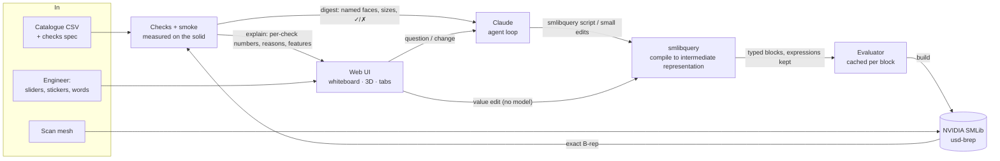

# Design

## Architecture

**One representation, two readers.** The script and its compiled graph are the single source of truth. Claude reads
the kernel's *digest* (named faces with exact sizes, failing checks); the engineer reads the same thing drawn as a
whiteboard, a feature tree with sliders, drawings and tables.

## Components

| Component | Path | Role |
|---|---|---|
| smlibquery | `packages/smlibquery/` | CadQuery-style API on SMLib. `workplane.py` records each call as a typed block; `script.py` compiles a script with catalogue values as tracked symbols; `kernel.py` builds each op on `usd_brep` (incl. `skin`, `wing`). |
| Graph + evaluator | `caddy/kernel/graph.py` | Validates the intermediate representation (JSON schema, wiring), evaluates expressions per configuration, caches every block by a hash of its op, params and inputs, so an edit rebuilds only what changed. |
| Faces and names | `caddy/kernel/build.py` | Labels every face with the block and part that made it (`hex.flat`, `body.shell`); tessellates at a size-relative chord; explains kernel failures. |
| Checks | `caddy/kernel/measure.py`, `data/families/*.checks.json` | The spec oracle: catalogue columns, ISO tables and rules measured on named faces (diameters, lengths, across-flats, gaps, overlap, extents, surface share), plus smoke invariants. |
| Session | `caddy/agent/session.py` | Holds the script, graph and per-size reports; `verdict()` for the loop, `digest()` for the model, `explain()` for the UI. |
| Agent loop | `caddy/agent/loop.py`, `prompts.py` | Claude with tools `build_cad`, `edit_cad`, `measure`, `why`, `check_stability` (read-only), `finish`. Every event is logged to a replayable JSONL run. |
| Stability | `caddy/kernel/stability.py`, `caddy/library/` | Tip and slip angles per body, exact on SMLib; the principle for the model; a friction lookup into 2,166 SimReady objects (ADR-12). |
| Server | `caddy/app/server.py` | FastAPI: state, meshes, previews, script edits and undo, locks, constraints in words, aero, drawings data, the event stream, Replay. |
| Front end | `caddy/app/static/` | Vanilla JS + three.js: history, live whiteboard, viewer, Feature tab, ISO/ASME sheets (`drawing.js`), Aero, Explainability, metrics dock. |
| Aero | `caddy/kernel/aero.py` | Vortex lattice on the model's `wing()` planforms + drag build-up from the kernel's exact areas. |
| Scan → CAD | `caddy/scan/` | Axis, slices, outline and primitive fit on SMLib (via `smlibpy`), a draft script, then Claude; every scan point checked against the solid. |

## Whiteboard cards

Every card reads the same way, top to bottom, so a step is understood at a glance:

1. **Who did it:** a chip naming where the step lives: *Claude*, *caddy*, *SMLib*/*kernel* or *you*.
2. **What it is:** a short title (detail goes in the hover, not on the card).
3. **A picture:** a kernel render of the model where the step changed or looked at it (script, fix, draft, scan,
   done, and a look at a named part, which lights that part up), otherwise a small drawing in the board's marker
   style (catalogue table, rejected script, magnifier, speech bubble, approve/reject box). The stability card draws
   the body on a slope at the angle where it first gives way, to scale from the kernel's numbers: centre of mass,
   pivot edge, and a slide or tip arrow.
4. One line of numbers, if the step has any.

New card kinds add a picture to `WB_PIC` in `whiteboard.js`; pictures are drawn at render time, not stored.

## Data formats

- **Script:** `import smlibquery as sq`; top-level `name = number` lines are design parameters; catalogue columns are
  free variables; `.tag("part.role")` names features.
- **Intermediate representation (graph):** `{"blocks": [{"id", "op", "part", "role", "params": {name: expression}, "inputs": [...], "line"}],
  "parameters": [...], "bodies": {...}}`.
- **Checks spec:** `{"id", "measure", "column" | "expect", "op", "tol", "a"/"b"/"target", "rule"}`.
- **Run log:** one JSON object per line: `start`, `response` (with token usage), `tool` (input, result, kernel
  verdict, explain), `end` (totals, cost, seconds). Replay re-executes every tool call on the kernel.

## Performance notes

- Block cache: an edit to one value rebuilds only downstream blocks.
- Tessellation chord scales with part size (0.01 mm on a fitting, ~1 mm on a car): a car's mesh went from 33 MB to
  0.4 MB and a flying-car rebuild from 65 s to 37 s with identical check results.
- Remaining cost on large lofted bodies is SMLib's booleans (~4–5 s each), the target of the next speed work.
